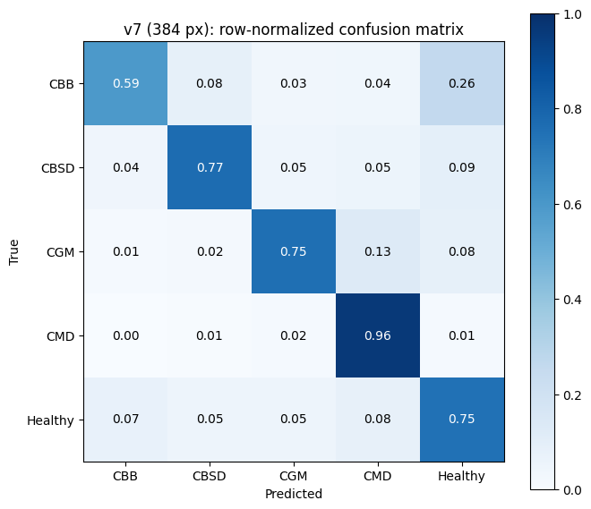
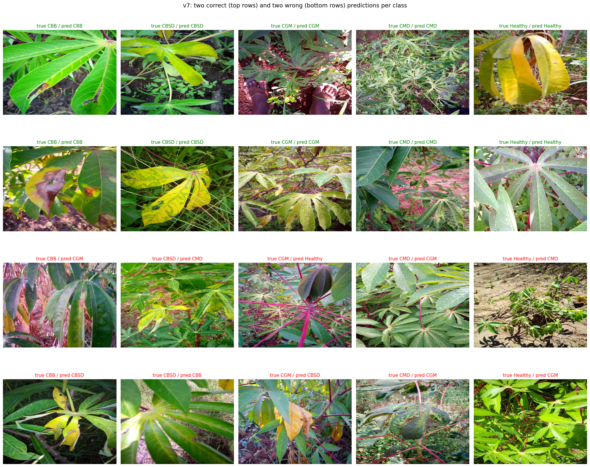

# Cassava Disease Classification | ResNet18, PyTorch

Classification of cassava leaf photos into 5 classes (4 diseases + healthy) from the [Cassava Leaf Disease Classification](https://www.kaggle.com/competitions/cassava-leaf-disease-classification) competition. A pretrained ResNet18 is improved step by step, changing one thing at a time.

     

## 📊 Results

Validation set: 4,280 images (stratified 20% split). Single run per experiment.

| Version | Change vs previous | Accuracy | Macro-F1 |
|---|---|---|---|
| Baseline | Always predict the largest class (CMD) | 0.615 | 0.152 |
| v1 | ResNet18, 224 px, lr 0.001, 3 epochs, horizontal flip | 0.759 | 0.514 |
| v2 | lr 0.0003, 8 epochs, cosine schedule | 0.831 | 0.692 |
| v3 | Class weights in the loss | 0.827 | 0.712 |
| v4 | Stronger augmentation | 0.811 | 0.714 |
| v5 | 15 epochs | 0.825 | 0.723 |
| v6 | Class weights removed | 0.850 | 0.736 |
| **v7** | **Resolution 384 px** | **0.874** | **0.772** |

Per-class F1 of v7: CMD 0.955, CBSD 0.794, CGM 0.774, Healthy 0.720, CBB 0.617.

- The largest gains came from training settings (v1 → v2) and higher resolution (v6 → v7). At 384 px, F1 improved for all 5 classes, and diseased leaves predicted as healthy dropped from 213 to 170.
- Class weights and stronger augmentation removed overfitting (train/val gap 15.8 → 5.3 points) and raised recall of rare classes, but changed the overall metrics by only about 0.02, close to run-to-run noise. Removing the weights again (v6) raised accuracy at the cost of rare-class recall.
- In the final model, validation loss stops improving after about epoch 9 while training loss keeps falling, so more epochs alone would not help.
- CBB, the smallest class (5% of data), remains the weakest.
- Some confidently "wrong" predictions look like mislabeled images, but only 83 such cases (<2% of validation) exist, so label noise explains only a small part of the errors.

<!-- >>> IMAGE: put v7_curves.png (from the Kaggle notebook's Output tab) into the images/ folder <<< -->

<!-- >>> IMAGE: put v7_confusion_matrix.png (from the Kaggle notebook's Output tab) into the images/ folder <<< -->

<!-- >>> IMAGE: put v7_examples.png (from the Kaggle notebook's Output tab) into the images/ folder <<< -->

## 🛠️ Approach

1. **Data.** 21,397 images, all 800×600. Strong imbalance: CMD 61.5%, CBB 5.1%. Stratified 80/20 split (17,117 train / 4,280 validation).
2. **Preprocessing.** Images stretched to a square (no cropping, so lesions near the edge are kept), ImageNet normalization. Augmentation only on training data.
3. **Model.** ResNet18 pretrained on ImageNet with a new 5-class output layer, AdamW optimizer.
4. **Experiments.** Each version changes one thing (except v2), with a prediction written before the run and the outcome after it.
5. **Error analysis.** Confusion matrix, per-class report and a review of the most confident wrong predictions.

## 📏 Metric

Because one class covers 61.5% of the data, accuracy alone is misleading: always predicting that class already gives 0.615. Macro-F1 is reported alongside it. It averages F1 over the classes with equal weight, so weak performance on rare classes is visible.

## ⚠️ Limitations

- One run per experiment; differences around 0.02 may be noise. GPU training is not fully deterministic, so a re-run gives slightly different numbers. The notes inside the notebook were written after an earlier run; this README uses the numbers of the published run.
- All versions were compared on the same validation split, with no separate test set and no Kaggle leaderboard submission, so the final score is slightly optimistic.
- v2 changed three settings at once, so their individual effects are unknown.
- The dataset has known label noise; judging which labels are wrong was done by eye, not by an expert.
- Only ResNet18 was tried, and only 224 and 384 px resolutions.

## ▶️ How to run

Open the notebook on Kaggle with the competition data attached, enable GPU and Internet (needed to download pretrained weights), and Run All (about 3 hours, because 7 models are trained).
Outputs in `/kaggle/working`: `results.csv` (per-class metrics of v5–v7), `v7_history.csv`, the three figures above, and model weights `v6_resnet18.pth`, `v7_resnet18_384.pth`.
